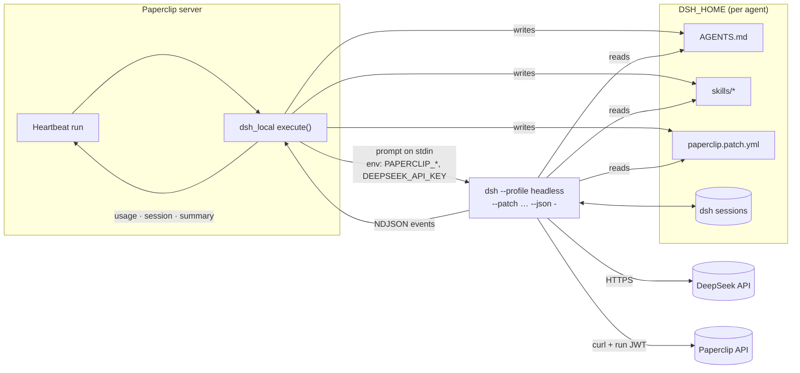

<div align="center">

# paperclip-adapter-dsh

**Run [Paperclip](https://github.com/paperclipai/paperclip) agents on [DeepSeek Harness](https://github.com/deepseek-ai/deepseek-harness) (`dsh`) with DeepSeek's API, InferX, or any OpenAI-compatible endpoint.**

[](https://github.com/vinayakv22/paperclip-adapter-dsh/actions/workflows/ci.yml)
[](LICENSE)


</div>

`dsh_local` is an external adapter plugin for Paperclip. It gives a Paperclip agent the same
first-class treatment the built-in `codex_local` and `claude_local` adapters get: a config form with
a model picker, readable run transcripts, session resume, skills, managed `AGENTS.md`
instructions, token accounting and an environment check. The work runs on DeepSeek models through
`dsh`'s own tools (shell, files, web, skills, subagents, MCP).

> [!NOTE]
> **This is a stopgap.** Upstream Paperclip work
> ([paperclipai/paperclip#18273](https://github.com/paperclipai/paperclip/pull/18273)) adds native
> dsh support through Paperclip's Runner/ACP path. It is not merged yet. When it ships in a
> Paperclip release, prefer the built-in support and retire this plugin.

## Contents

- [Why](#why)
- [How it works](#how-it-works)
- [Features](#features)
- [Install on a Paperclip host](#install-on-a-paperclip-host)
- [Configure an agent](#configure-an-agent)
- [Fallback for Codex agents](#fallback-for-codex-agents)
- [Providers: InferX, DeepSeek, custom](#providers-inferx-deepseek-custom)
- [Models, MCP and permissions](#models-mcp-and-permissions)
- [Restricting MCP tools](#restricting-mcp-tools)
- [Sessions, skills and AGENTS.md](#sessions-skills-and-agentsmd)
- [Telemetry and secrets](#telemetry-and-secrets)
- [Troubleshooting](#troubleshooting)
- [Limitations](#limitations)
- [Development](#development)

## Why

Before this adapter, the usual way to run dsh under Paperclip was the generic `process` adapter
plus a wrapper script. That works, but the process adapter only passes four environment variables
and an exit code, so the bridge has to rebuild everything else:

| | `process` adapter + bridge script | `dsh_local` (this plugin) | Upstream #18273 |
|---|---|---|---|
| Config form, model picker | No | Yes | Yes |
| Task context and wake prompt | Re-fetched over the API | Paperclip's own prompt sections | Native |
| Readable transcript (thinking, tools) | Raw JSON lines | Yes (UI parser) | Yes |
| Token usage and cost attribution | No | Yes, per run | Yes |
| Success check | Exit code only | Exit 0, a `final` event **and** stop reason `completed` | Native |
| Session resume / reset from Paperclip | Private state file | Paperclip session params | Native |
| Skills and `AGENTS.md` bundle | Pasted into the prompt | Synced into `DSH_HOME` | Native |
| Available today | Yes | Yes | Not merged |

## How it works



Each run:

1. Resolves the workspace `cwd` from Paperclip, builds the `PAPERCLIP_*` environment (run id, task,
   wake reason, workspace, run-scoped API token) and merges the agent's `env`, including resolved
   secrets such as `DEEPSEEK_API_KEY`.
2. Prepares the agent's `DSH_HOME`: copies the instructions file to `AGENTS.md`, symlinks the
   agent's Paperclip skills into `skills/`, and writes `paperclip.patch.yml` (model, telemetry, MCP).
3. Builds the prompt from Paperclip's standard sections (wake prompt, task context, handoff,
   heartbeat template) plus a short note on calling the Paperclip API with `curl`.
4. Runs `DSH_PERMISSION_MODE=<mode> dsh --profile headless --patch <file> --json [--session-id …] -`
   with the prompt on stdin, streaming the NDJSON events to the run log.
5. Parses the stream into usage, session id and the final answer, and reports them to Paperclip.

## Features

- **Providers**: InferX's OpenAI-compatible DeepSeek endpoint (picked automatically when
  `DEEPSEEK_INFERX_API_KEY` is set), DeepSeek's own API as the fallback, or any OpenAI-compatible gateway.
- **DeepSeek models**: `deepseek-flash` (default), `deepseek-v4-pro`, or `deepseek-v4.1-flash-1017-basic` on InferX, picked per agent.
- **Session resume** with `--session-id` when the workspace and `DSH_HOME` match; if dsh no longer
  knows the session, the run retries fresh automatically and Paperclip's session is cleared.
- **Managed instructions**: Paperclip's instructions bundle editor works; the file is synced to
  `$DSH_HOME/AGENTS.md`, which dsh loads as user-global instructions.
- **Skills**: Paperclip skills appear in dsh's skill tool, with list/sync from the Paperclip UI.
- **MCP servers** over `streamable-http` or `stdio`, with `${ENV}` secret references.
- **Accurate usage**: dsh reports Anthropic-style counters (input excludes cache); the adapter reports
  `inputTokens = input + cacheRead + cacheWrite` and `cachedInputTokens = cacheRead`, per run.
- **Readable transcripts**: a zero-dependency UI parser renders thinking, tool calls, tool results and
  the final result with token totals.
- **Telemetry off by default**: session-log upload to DeepSeek is disabled.
- **Environment test**: checks dsh, Node version, DeepSeek key presence and a writable `DSH_HOME`.
- **Codex fallback**: a Codex agent can switch to `dsh_local` by changing only `adapterType` and `model`.

## Install on a Paperclip host

### 1. Install dsh for the user that runs Paperclip

dsh needs **Node.js ≥ 24.9** on that user's `PATH`.

```sh
sudo -u paperclip -H bash -lc 'npm install -g --prefix "$HOME/.local" @deepseek-ai/dsh && "$HOME/.local/bin/dsh" --version'
```

### 2. Build the adapter

```sh
sudo -u paperclip -H bash -lc '
  mkdir -p ~/.paperclip/adapter-src && cd ~/.paperclip/adapter-src &&
  git clone https://github.com/vinayakv22/paperclip-adapter-dsh.git && cd paperclip-adapter-dsh &&
  npm install --ignore-scripts && npm run build'
```

`--ignore-scripts` skips esbuild's postinstall, which the build does not need.

### 3. Register it with Paperclip

Through the API (add `-H "Authorization: Bearer <board token>"` unless the instance runs in
`local_trusted` mode):

```sh
curl -X POST http://127.0.0.1:3100/api/adapters \
  -H 'Content-Type: application/json' \
  -d '{"localPath": "/home/paperclip/.paperclip/adapter-src/paperclip-adapter-dsh"}'
```

Or add an entry to `~/.paperclip/adapter-plugins.json` and restart Paperclip:

```json
[
  {
    "packageName": "paperclip-adapter-dsh",
    "localPath": "/home/paperclip/.paperclip/adapter-src/paperclip-adapter-dsh",
    "type": "dsh_local",
    "installedAt": "2026-11-01T00:00:00.000Z"
  }
]
```

Paperclip picks up rebuilt local adapters on restart. To update: `git pull && npm install --ignore-scripts && npm run build`, then restart.

### 4. Give agents an API key

Create a Paperclip secret holding the key and bind it in the agent's environment
(`DEEPSEEK_INFERX_API_KEY` for InferX, `DEEPSEEK_API_KEY` for DeepSeek's API). For a host-wide default
(useful for [Codex fallback](#fallback-for-codex-agents)), put it in `~/.paperclip-dsh/.env` instead:

```sh
sudo -u paperclip -H bash -c 'umask 077; mkdir -p ~/.paperclip-dsh; read -rsp "DeepSeek key: " k; echo; printf "DEEPSEEK_API_KEY=%s\n" "$k" >> ~/.paperclip-dsh/.env'
```

Use the same command with `DEEPSEEK_INFERX_API_KEY` for the InferX key; both can live in the file.
The adapter only reads `DEEPSEEK_*` lines from that file, uses each one only when the agent's own
environment does not set that variable, and refuses the file unless it is mode `600`.

## Configure an agent

Pick **DeepSeek Harness (local)** as the agent's adapter, or set it through the API:

```json
{
  "adapterType": "dsh_local",
  "adapterConfig": {
    "model": "deepseek-flash",
    "permissionMode": "workspace-write",
    "mcpServers": {
      "openseo": {
        "transport": "streamable-http",
        "url": "https://app.openseo.so/mcp",
        "bearerTokenEnv": "OPENSEO_API_KEY"
      }
    },
    "timeoutSec": 3600,
    "env": {
      "DEEPSEEK_API_KEY": { "type": "secret_ref", "secretId": "<secret id>" },
      "OPENSEO_API_KEY": { "type": "secret_ref", "secretId": "<secret id>" }
    }
  }
}
```

| Key | Default | Meaning |
|---|---|---|
| `model` | `deepseek-flash` | `deepseek-flash`, `deepseek-v4-pro`, or aliases `flash` / `pro`. Non-DeepSeek ids fall back to the default. |
| `permissionMode` | `workspace-write` | `workspace-write`, `read-only` or `danger-full-access`, set as `DSH_PERMISSION_MODE`. Approval requests are always rejected. |
| `addDirs` | none | Not supported by dsh 0.2.x, which has one writable root per session; listed paths only produce a warning. |
| `mcpServers` | none | JSON object `name → {transport, url, bearerTokenEnv, headers, command, args, env, enabledTools, disabledTools}`. See [Restricting MCP tools](#restricting-mcp-tools). |
| `instructionsFilePath` | managed by Paperclip | Copied to `$DSH_HOME/AGENTS.md` before each run. |
| `cwd` | Paperclip workspace | Fallback working directory. |
| `env` | none | Environment for dsh, including secret bindings. Set it with Paperclip's environment editor. |
| `promptTemplate`, `bootstrapPromptTemplate` | Paperclip defaults | Prompt overrides. |
| `command` | `dsh` | dsh executable. A command that is not dsh (e.g. a Codex launcher) is ignored. |
| `dshHome` | `~/.paperclip-dsh/agents/{agentId}` | Per-agent home; `~` and `{agentId}` are expanded. |
| `disableTelemetry` | `true` | Disable session-log upload to DeepSeek. |
| `timeoutSec` / `graceSec` | `0` / `15` | Run timeout (0 = none) and SIGTERM→SIGKILL grace. |
| `dshExtraArgs` | none | Extra dsh arguments, one per line. |

## Fallback for Codex agents

The adapter is designed so a Codex agent can be moved to DeepSeek when Codex hits its usage limit,
and moved back when Codex resets, **by changing only `adapterType` and `model`**:

```json
{ "adapterType": "dsh_local", "adapterConfig": { "...everything the Codex agent already had...": "", "model": "deepseek-flash" } }
```

What carries over and what is ignored:

| Codex `adapterConfig` key | Under `dsh_local` |
|---|---|
| `instructionsFilePath`, `cwd`, `env`, `timeoutSec`, `graceSec`, `promptTemplate`, `bootstrapPromptTemplate` | Used as-is |
| `model` (a GPT/Codex id left behind) | Replaced by `deepseek-flash`, with a warning in the run log |
| `command` pointing at `codex` / `codex-lb` | Ignored; `dsh` runs instead |
| `extraArgs` (Codex `-c …` flags) | Ignored; dsh arguments live in `dshExtraArgs` |
| `modelReasoningEffort`, `engine`, other Codex-only keys | Ignored |
| Codex session (thread id in Paperclip's session params) | Never passed to dsh; the first dsh run starts fresh |

Things the swapping process should take care of:

- **DeepSeek key.** Codex agents have no `DEEPSEEK_API_KEY` binding. Either add one, or provide the
  host-wide `~/.paperclip-dsh/.env` described in [Install](#4-give-agents-a-deepseek-key).
- **Save and restore the original** `adapterType` + `adapterConfig`; this adapter does not write
  them back.
- **Reset the session on each swap** (`POST /api/agents/:id/runtime-state/reset-session`). The
  adapter already refuses foreign sessions, but resetting keeps Codex from trying to resume a dsh
  session id when it comes back.
- **Tools differ.** MCP servers configured through Codex `-c` flags do not carry over; give the
  agent `mcpServers` if it needs them under dsh.

## Providers: InferX, DeepSeek, custom

dsh ships one model route, `deepseek-official` (DeepSeek's API, key `DEEPSEEK_API_KEY`). Any other
OpenAI-compatible endpoint is declared as a route of dsh's `llm-pi-ai` plugin
(`@deepseek-ai/dsh-llm-pi-ai`), and `agent-default-model` points the agent at it. The adapter writes
both rows into the patch file from these keys:

| Key | Default | Meaning |
|---|---|---|
| `provider` | `auto` | `auto`, `inferx`, `deepseek-official`, or a lowercase name for your own route |
| `baseUrl` | InferX: `https://model.inferx.net/endpoints/v1` | OpenAI-compatible base URL (required for a custom route) |
| `apiKeyEnv` | InferX: `DEEPSEEK_INFERX_API_KEY` | Env var holding the key; only the name is written to disk (required for a custom route) |
| `model` | `deepseek-flash` | On InferX, `deepseek-flash` / `flash` mean `deepseek-v4.1-flash-1017-basic` |
| `providerApi` | `openai-completions` | `openai-completions`, `openai-responses` or `anthropic-messages` (custom routes) |
| `providerRetry` | InferX: 12 retries, 2 s to 30 s; others: dsh default | Retry policy for the route, or `"default"` |
| `providerCompat` | none | pi-ai wire-compat switches, e.g. `{"thinkingFormat": "deepseek"}` |
| `contextWindow` | InferX Flash: 262,144; others: dsh fallback 262,144 | The model's real window; dsh compacts the session before it fills |
| `maxTokens` | unset (dsh default 32,768) | Output cap per request; values below 8,192 are raised to 8,192 |

**`auto`** uses InferX when `DEEPSEEK_INFERX_API_KEY` is in the run environment (an env binding or
`~/.paperclip-dsh/.env`) and the model is a Flash model (`deepseek-flash`, `flash`, unset, or a Codex
model left behind after a swap). Otherwise it uses `deepseek-official`, so DeepSeek's API stays the
fallback: remove the InferX key, or set `provider: deepseek-official`, to switch back. `deepseek-v4-pro`
always goes to DeepSeek's API.

For InferX the generated rows look like this:

```yaml
- id: agent-default-model
  config:
    provider: "inferx"
    model: "deepseek-v4.1-flash-1017-basic"

- id: llm-pi-ai
  config:
    providers:
      "inferx":
        displayName: "InferX (DeepSeek)"
        api: openai-completions
        baseURL: "https://model.inferx.net/endpoints/v1"
        apiKeyEnv: "DEEPSEEK_INFERX_API_KEY"
        models:
          - id: "deepseek-v4.1-flash-1017-basic"
            name: "DeepSeek V4.1 Flash (InferX)"
            contextWindow: 262144
```

Three InferX specifics the defaults account for:

- **Context window is 262,144 tokens**, not the 1,048,576 dsh assumes for `deepseek-flash` on
  DeepSeek's API. The adapter writes `contextWindow: 262144` into the route's model row so dsh's
  compaction starts in time instead of after the endpoint has already rejected an oversized request.
  Set `contextWindow` only if InferX changes it.
- **Reasoning comes out of the output budget.** The model thinks before it answers, and those tokens
  count against the output cap: a 20-token cap returned a truncated reply. The adapter leaves the cap at
  dsh's default (32,768) and raises any configured `maxTokens` below 8,192 to 8,192.
- **The free endpoint runs out of capacity.** It answers `429 … all replicas at capacity` for about
  a minute at a time. dsh's default retry policy gives up after roughly 15 seconds (5 retries, 0.5 s
  doubling to 10 s), and the run then fails. The InferX route therefore carries
  `retryPolicy: {mode: normal, maxRetries: 12, backoff: {initialDelayMs: 2000, maxDelayMs: 30000}}`,
  which waits out about 4.5 minutes.
  - Override it with `providerRetry`: a JSON object with dsh's `mode`, `maxRetries`,
    `retryableCodes` and `backoff` fields.
  - Set `providerRetry: "default"` to use dsh's own policy.
  - A custom route uses dsh's default unless `providerRetry` is set.

Prompts stay small, which matters more with the smaller window: agent instructions are synced to
`$DSH_HOME/AGENTS.md` (dsh loads them as user-global instructions) instead of being pasted into the
task, and a resumed session gets Paperclip's compact task brief plus the new wake events rather than
the full brief and heartbeat template again.

A custom gateway:

```json
{ "provider": "acme", "baseUrl": "https://gw.example.com/v1", "apiKeyEnv": "ACME_API_KEY", "model": "acme-think" }
```

dsh resolves `apiKeyEnv` per request; a variable that is unset fails the run with `MISSING_CREDENTIAL`.
The environment test reports the chosen provider and model and checks that the key variable for it is
present. Runs report `provider` / `biller` as `inferx` (or the custom route name), or `deepseek` for
DeepSeek's API.

## Models, MCP and permissions

**Models.** The model is pinned with a dsh patch row, which replaces the
`agent-default-model` plugin's config (DeepSeek's API shown; see [Providers](#providers-inferx-deepseek-custom) for InferX):

```yaml
- id: agent-default-model
  config:
    provider: "deepseek-official"
    model: "deepseek-v4-pro"
```

**MCP.** Each server becomes an inserted `@deepseek-ai/dsh-mcp-client` row. Any `${NAME}` inside a
URL, header, command, argument or env value is written as a `!!js` template literal that dsh evaluates
against its environment, so the generated file never contains the secret:

```yaml
- insert:
    - id: "mcp-openseo"
      name: '@deepseek-ai/dsh-mcp-client'
      config:
        serverName: "openseo"
        transport: streamable-http
        url: "https://app.openseo.so/mcp"
        headers:
          "Authorization": !!js "`Bearer ${process.env.OPENSEO_API_KEY ?? \"\"}`"
```

**Bearer tokens.** Use `"bearerTokenEnv": "OPENSEO_API_KEY"` (Codex's `bearer_token_env_var` spelling works too) rather than a
`headers.Authorization` value. Paperclip masks values stored under credential-looking keys in `adapterConfig` and writes
`***REDACTED***` in their place, which the server then rejects with an empty-bodied 401. The adapter builds the header from the
variable name at run time and skips a server whose header is the placeholder, with a warning.

**Permissions.** `permissionMode` is exported as `DSH_PERMISSION_MODE`, which the headless
profile's `sandbox-policy` row reads (`read-only`, `workspace-write` or `danger-full-access`). The
mode governs file writes only: shell commands keep network access. No one is present to approve tool
calls, so the patch sets the `approval` row to `policy: never` (requests are rejected instead of
waiting) and unmounts the interactive `permission` preset switcher, which refuses to activate under
that policy. dsh 0.2.x has a single writable root per session (the workspace) and no `--add-dir`;
an agent that must write outside its workspace, e.g. to a worktree's shared `.git`, needs
`danger-full-access`.

## Restricting MCP tools

dsh's MCP client mounts every tool a server offers and has no allowlist (Codex's `enabled_tools`
equivalent). To hide tools, e.g. the paid ones on OpenSEO, give the server `enabledTools` (keep only
these) and/or `disabledTools` (remove these after the allowlist):

```json
{
  "mcpServers": {
    "openseo": {
      "url": "https://app.openseo.so/mcp",
      "bearerTokenEnv": "OPENSEO_API_KEY",
      "enabledTools": ["whoami", "list_projects", "get_project_context"]
    }
  }
}
```

`enabled_tools` / `disabled_tools` are accepted too, so a Codex list can be pasted as is. A server
with a filter is mounted as a **stdio relay** instead of a direct connection:

```
dsh mcp-client --stdio--> paperclip-dsh-mcp-filter --streamable-http--> upstream server
```

The relay (`dist/mcp-filter/cli.js`, bin `paperclip-dsh-mcp-filter`) connects to the upstream as an MCP
client, answers `tools/list` with the filtered list (fetched live, so upstream changes show up),
passes the server `instructions` through, and answers `tools/call` for any other tool with an
`isError` result **without contacting the upstream**. The model neither sees nor can call the hidden
tools. Tool names stay `mcp__<serverName>__<tool>`.

- **Secrets.** Header values (with their `${NAME}` references) are handed to the relay as env vars of
  the stdio server, not argv or the patch file. dsh strips `KEY`/`TOKEN`/`SECRET`-style names from the
  ambient env it gives a stdio child, but not from the server's own `env`, so the key reaches the
  relay. The relay refuses to start if a referenced variable is unset.
- **Empty list.** `enabledTools: []` exposes nothing. Omit the key for no restriction.
- **stdio upstreams.** Filtering is only implemented for `streamable-http` servers. A stdio server with
  `enabledTools`/`disabledTools` is skipped with a warning rather than mounted unfiltered.
- **Scope.** Only tools are relayed; the upstream's resources and prompts are not exposed through a
  filtered server.

The relay also runs standalone:

```
paperclip-dsh-mcp-filter --url https://app.openseo.so/mcp --bearer-env OPENSEO_API_KEY \
  --enable whoami,list_projects [--disable tool] [--header-env Name=ENV_VAR] [--enable-none]
```

## Sessions, skills and AGENTS.md

**Per-agent `DSH_HOME`.** Every agent gets its own home (default `~/.paperclip-dsh/agents/<agentId>`).
dsh keeps its session store there, and the adapter manages three entries:

| Path | Managed by | Purpose |
|---|---|---|
| `AGENTS.md` | adapter, every run | Copy of the agent's instructions; dsh loads it as user-global instructions |
| `skills/<name>` | adapter + Paperclip skill sync | Symlinks to Paperclip skills; dsh's skill-filesystem plugin scans them |
| `paperclip.patch.yml` | adapter, every run | Model, telemetry and MCP overlay passed with `--patch` |

Edit instructions in Paperclip, not in `AGENTS.md`: the copy is overwritten on the next run. A
user-written `AGENTS.md` (without the adapter's marker comment) is never deleted.

**Sessions.** dsh binds a session to one `DSH_HOME` and one cwd. The adapter stores both next to the
session id and resumes only when they match, so moving an agent to another workspace starts a fresh
session instead of failing. If dsh still refuses the id (the session was deleted, for example), the
run retries once without it. Resetting the session in Paperclip starts fresh on the next run.

## Telemetry and secrets

- `disableTelemetry` (default `true`) disables dsh's `session-log-deepseek` plugin in the patch and
  sets `DSH_TELEMETRY_MODE=DISABLED`. Transcripts stay in `DSH_HOME` on your host.
- Model calls go to the DeepSeek API and are billed to your key; usage is reported to Paperclip with
  `provider: "deepseek"`, `biller: "deepseek"`, `billingType: "api"`.
- The adapter never logs secret values. Keys reach dsh only through the process environment; the
  generated patch uses `${ENV}` references; Paperclip's invocation log redacts the environment.
- The agent receives a run-scoped Paperclip token as `PAPERCLIP_API_KEY` and is told to send
  `X-Paperclip-Run-Id` on writes so Paperclip can attribute its actions to the run.

### Credentials in the agent's shell

dsh 0.2.x strips every variable whose name matches `KEY|PASSWORD|SECRET|TOKEN` (any case) from the
environment of the commands its shell tool runs. Without help, `$PAPERCLIP_API_KEY` is empty inside
the agent's `curl` calls. On a local trusted Paperclip the unauthenticated calls still succeed, but
they are recorded as the board user, not as the agent.

The adapter puts those values back:

- It passes each value to dsh under a name the scrub ignores (`PAPERCLIP_FWD_NAMES`,
  `PAPERCLIP_FWD_V0`, `PAPERCLIP_FWD_V1`, …).
- It points `BASH_ENV` at `$DSH_HOME/paperclip-bash-env.sh`. That static script holds no secret.
  Non-interactive bash sources it before every command; it re-exports the real names and unsets the
  carriers. An existing `BASH_ENV` is chained.
- `PAPERCLIP_API_KEY` and `PAPERCLIP_RUNTIME_TOOLS_TOKEN` are always forwarded when Paperclip sets
  them.
- Other credentials, for example a `GH_TOKEN` binding, are forwarded only when listed in
  `forwardEnv`: an array, or one name per line.
- Provider keys (`DEEPSEEK_*`) and `DSH_*` are never forwarded; they stay with the dsh process.
- The run log says which names were forwarded:
  `[paperclip] Forwarding PAPERCLIP_API_KEY, … to the dsh shell tool via BASH_ENV`.

## Troubleshooting

| Symptom | Fix |
|---|---|
| Environment test: `Cannot run "dsh --version"` | Install dsh for the Paperclip user, or set `command` to the absolute path (e.g. `/home/paperclip/.local/bin/dsh`). |
| `node … is older than 24.9.0` | The `node` on the Paperclip user's `PATH` is too old for dsh. Upgrade Node or put a newer one first on `PATH`. |
| `authentication_required` / DeepSeek 401 | The key for the chosen provider (`DEEPSEEK_INFERX_API_KEY` or `DEEPSEEK_API_KEY`) is missing or wrong. Check the secret binding or `~/.paperclip-dsh/.env` (mode 600). |
| `MISSING_CREDENTIAL` naming a route | The route's `apiKeyEnv` variable is not set in the run environment. |
| Run log shows the wrong provider | Look for `[paperclip] Provider …, model … (auto: …)`: it says why `auto` chose it. Set `provider` explicitly to override. |
| `rate_limited` / `insufficient_balance` | DeepSeek returned 429 / 402. Wait, or top up the account. |
| `Not resuming dsh session …` in the log | Expected after a workspace or `DSH_HOME` change, or after a swap from another adapter. |
| `dsh stopped: max_steps` (or another reason) | dsh ended without completing; the run is marked failed. Check the transcript for the reason. |
| Commits fail with permission errors in a worktree | dsh 0.2.x only allows writes under the workspace; use `permissionMode: danger-full-access` for that agent. |
| Agent comments show up as the board user, or `curl …/api/agents/me` returns 401 | The run token did not reach the shell. Look for `[paperclip] Forwarding PAPERCLIP_API_KEY` in the run log (needs adapter 0.1.3+). A warning `No Paperclip run token` means Paperclip minted none: check the host's agent JWT secret. |
| MCP tool missing | Look for `[paperclip] MCP config references ${X} but it is not set` in the run log, and check the server name rules (`[A-Za-z0-9_-]`). |

Run logs prefix the adapter's own lines with `[paperclip]`. The generated patch is at
`$DSH_HOME/paperclip.patch.yml` if you want to see exactly what dsh loaded.

## Limitations

- **Local execution only.** Remote SSH or sandbox execution targets are refused.
- **Cost is not computed.** Paperclip gets token counts; dollar cost is left to Paperclip's pricing.
- **dsh is a developer preview.** Its event stream, flags and plugin ids may change between releases.
  The parser ignores unknown events, but pin a dsh version you have tested.
- **No interactive approvals.** Tool calls the permission mode does not allow are denied, not queued.
- **Retire when upstream ships.** Once Paperclip includes native dsh support (#18273), migrate agents
  to it.

## Development

```sh
npm install --ignore-scripts
npm run typecheck
npm test          # vitest: stream parser, usage math, patch, session codec, UI parser, execute with a fake dsh
npm run build
```

The tests never call the DeepSeek API: `tests/fixtures/fake-dsh.mjs` stands in for dsh, records how
it was called and replays a scripted event stream.

Layout:

```
src/
  index.ts             createServerAdapter() and the agent configuration doc
  constants.ts         adapter id, model catalog, defaults
  ui-parser.ts         zero-import transcript parser served to the Paperclip UI
  mcp-filter/          tool-filtering MCP relay (bin paperclip-dsh-mcp-filter)
  server/
    execute.ts         one heartbeat run
    stream.ts          NDJSON event parser and usage math
    patch.ts           paperclip.patch.yml generator (model, telemetry, MCP)
    config.ts          adapterConfig normalisation and dsh argv
    home.ts            DSH_HOME layout, AGENTS.md sync, shared key file
    session.ts         session codec and resume rules
    skills.ts          skill list/sync
    test.ts            environment test
    config-schema.ts   agent editor form
```

## License

[MIT](LICENSE) © vinayakv22. Not affiliated with DeepSeek or Paperclip.
